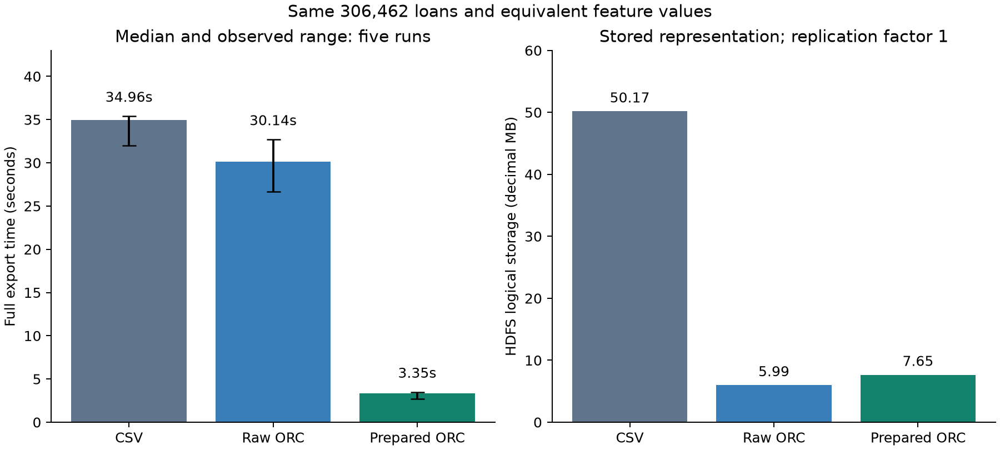
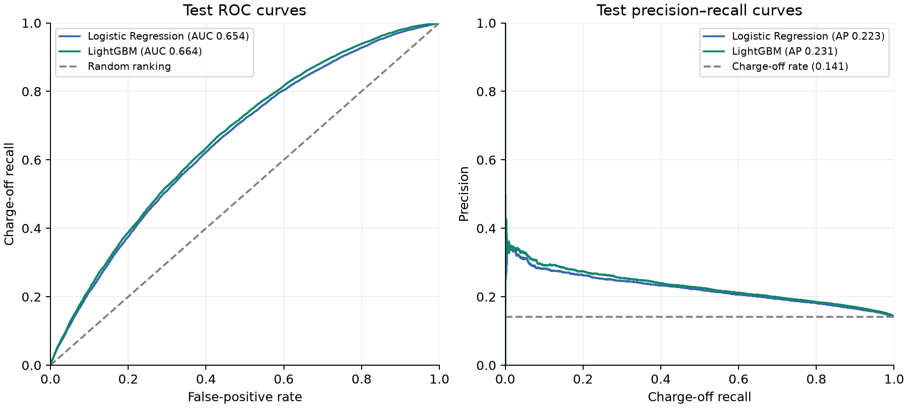
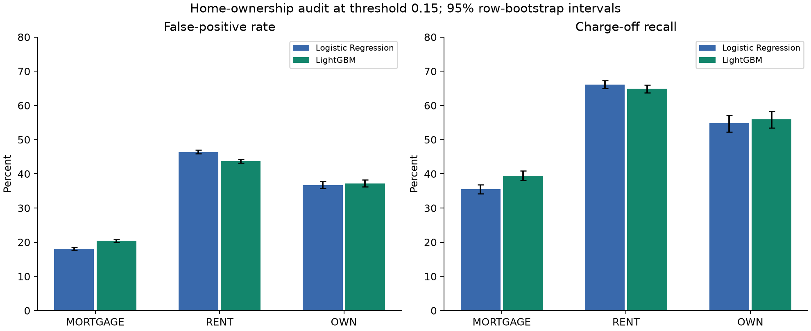
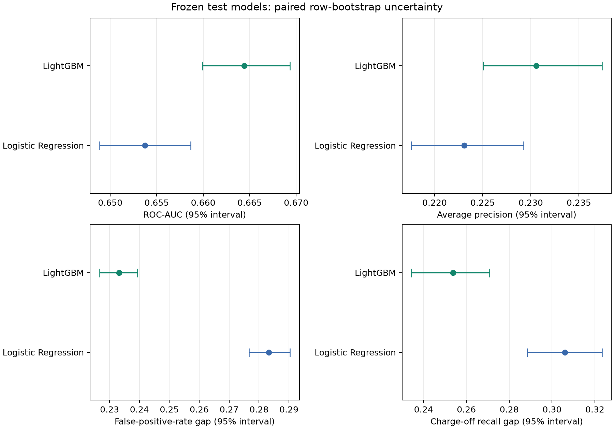

# A Reproducible Benchmark of Credit Risk Pipelines: A Hive Study

Results report draft — assembled from saved experiment outputs on 8 November 2026.

## Abstract

This project studies how Hive pipeline design affects the preparation and export of credit-risk features. It uses a public Lending Club dataset to construct a cohort of 306,462 resolved, 36-month loans issued during 2012–2014. Three pipelines are compared: CSV with features calculated during queries, raw ORC with the same calculations, and prepared ORC with features stored in advance. Data-equivalence checks confirm matching feature values. Median complete-export times over five measured runs are 34.96, 30.14 and 3.35 seconds, respectively. Separately, Logistic Regression and LightGBM predict charged-off versus fully paid loans using the same 19 inputs. Their held-out test ROC-AUC scores are 0.6537 and 0.6644. A home-ownership audit finds smaller disparities for LightGBM, although substantial gaps remain. The results support prepared ORC for repeated feature exports in this single-machine experiment, with preparation cost reported separately. They do not establish large-cluster scalability, deployment-ready risk prediction, or absence of discrimination.

## 1. Problem and research questions

The lecturer's brief is to predict borrower risk, audit differences across groups, and benchmark Hive-based pipeline designs on accuracy, latency and cost. The main question is: which of the tested Hive designs exports equivalent credit-risk features most efficiently on this dataset and machine, and why?

The supporting questions are whether LightGBM improves on a simple Logistic Regression baseline and how their error rates differ across home-ownership groups. Pipeline speed and prediction quality are separate comparisons: changing storage format is not claimed to improve model accuracy.

## 2. References and relationship to prior work

1. *Bank loan analysis using customer usage data: A big data approach using Hadoop*, IEEE TEL-NET, 2017. Paper ID / DOI: [10.1109/TEL-NET.2017.8343582](https://doi.org/10.1109/TEL-NET.2017.8343582). This is the architectural background for Hadoop/HDFS/Hive loan analysis. Our project adds a controlled storage-and-feature-pipeline comparison, predictive baselines and a quantitative group audit.
2. *Assessing Fairness and Transparency in Credit Scoring Using Explainable AI*, IEEE CISCON, 2025. Paper ID / DOI: [10.1109/CISCON66933.2025.11337606](https://doi.org/10.1109/CISCON66933.2025.11337606). This motivates modern Lending Club modelling and fairness/transparency analysis. It compares tree-based models and discusses explainability; our implemented contribution is an explicit group-error audit combined with the Hive benchmark. SHAP and fairness mitigation have not been implemented here.

This is a related-work extension, not an exact reproduction of either paper. Their reported scores are not directly comparable because cohorts, features, class distributions and evaluation procedures differ. No claim is made that using LightGBM for lending is new, or that this is the first Hive fairness benchmark.

<!-- BEGIN RESEARCH COMPARISON -->
### Comparison of the reference papers and our outcomes

The following is a comparison of published findings and our recorded outcomes, not a matched replication. The 2017 study, the 2025 study and our project address different parts of the problem. Kaggle supplies the dataset and is not a third research paper with its own model scores.

#### What the 2017 paper reports

**Bank loan analysis using customer usage data: A big data approach using Hadoop** (paper ID / DOI: 10.1109/TEL-NET.2017.8343582) uses Hadoop/HDFS/Hive to summarize Lending Club data from January 2012 through December 2016 (approximately 1 GB). Their results include loan issuance, purposes, grade-based summaries and loan statuses. For example, they report debt consolidation at 58.88% of purposes and mean interest rates of 11.21% for 36-month loans, 15.32% for 60-month loans and 12.18% overall (PDF pp. 4 and 7). These are descriptive findings, not predictive accuracy. No accuracy, F1, recall or ROC-AUC is reported for a trained model in their own analysis, and no directly comparable pipeline latency is reported. Our project does not reproduce those descriptive statistics on an identical cohort, so no numeric improvement over those statistics is claimed.

#### What the 2025 paper reports, alongside our model results

**Assessing Fairness and Transparency in Credit Scoring Using Explainable AI** (paper ID / DOI: 10.1109/CISCON66933.2025.11337606) reports the following in Table V (PDF p. 6). Our rows come from the frozen test evaluation. All values in this table are fractions, not percentages.

| Study | Model | Accuracy | Recall | F1 | ROC-AUC |
| --- | --- | --- | --- | --- | --- |
| Assessing Fairness and Transparency in Credit Scoring Using Explainable AI (2025; DOI: 10.1109/CISCON66933.2025.11337606) | Random Forest | 0.8180 | 0.7318 | 0.8010 | 0.8883 |
| Assessing Fairness and Transparency in Credit Scoring Using Explainable AI (2025; DOI: 10.1109/CISCON66933.2025.11337606) | LightGBM | 0.8284 | 0.7412 | 0.8111 | 0.8981 |
| Assessing Fairness and Transparency in Credit Scoring Using Explainable AI (2025; DOI: 10.1109/CISCON66933.2025.11337606) | XGBoost | 0.8285 | 0.7425 | 0.8123 | 0.8988 |
| Our project | Logistic Regression | 0.6595 | 0.5336 | 0.3068 | 0.6537 |
| Our project | LightGBM | 0.6610 | 0.5434 | 0.3117 | 0.6644 |

The published XGBoost row has the highest reported AUC (0.8988); the paper’s LightGBM AUC is 0.8981. Our LightGBM AUC is 0.6644. Therefore, we do not claim a predictive-score improvement over that paper. Our main comparison is between our own pipelines under shared controls, not a claim that our classifier beats the published models.

#### Differences in scope and implemented evidence

| Aspect | Bank loan analysis using customer usage data: A big data approach using Hadoop (2017; DOI: 10.1109/TEL-NET.2017.8343582) | Assessing Fairness and Transparency in Credit Scoring Using Explainable AI (2025; DOI: 10.1109/CISCON66933.2025.11337606) | Our project |
| --- | --- | --- | --- |
| Main outcome | Historical loan/purpose/grade/status summaries. | Predictive model scores and qualitative SHAP interpretation. | Equivalent-data Hive export benchmark, predictive baselines and group error audit. |
| Dataset/cohort | Approximately 1 GB of Lending Club data, Jan 2012–Dec 2016. | Lending Club; exact cohort and split protocol insufficiently specified for a matched rerun. | 306,462 resolved 36-month loans, 2012–2014; 90,615-loan test split. |
| Predictive models | No trained predictive model evaluated in the reported analysis. | Random Forest, LightGBM and XGBoost. | Dummy baseline, Logistic Regression and LightGBM. |
| Class balance / decision rule | Not a predictive classification evaluation. | States undersampling for class balance; discusses NearMiss/Tomek Links. Threshold and split details not fully specified. | Original selected-cohort imbalance retained; validation maximum-F1 rule selects 0.15 for both trained models. |
| Input features | Dataset section reports 74 retained attributes for descriptive analysis. | Table II lists 26 predictors plus target; includes interest rate, grade, subgrade and term. | 19 model inputs; uses FICO midpoint and credit-history months; does not use interest rate or grades. |
| Hive pipeline benchmark | Uses Hive/HiveQL, but no matched CSV/raw-ORC/prepared-ORC timing benchmark is reported. | No Hive storage/materialization benchmark reported. | Five measured exports per pipeline; median 34.96 s (CSV), 30.14 s (raw ORC), 3.35 s (prepared ORC). |
| Storage / preparation cost | Dataset size is described; no comparable pipeline cost breakdown reported. | No comparable pipeline storage/preparation experiment reported. | Raw CSV 50.17 MB; raw ORC 5.99 MB; prepared ORC 7.65 MB. Estimated two-stage preparation 37.39 s. |
| Quantitative group audit | No group error-rate disparity metrics reported. | Fairness/SHAP discussion, but no numeric group FPR/recall gaps in the supplied paper. | MORTGAGE/RENT/OWN audit: LightGBM FPR gap 23.32 pp and recall gap 25.37 pp. Substantial disparities remain. |
| Explainability | Descriptive charts, not individual model explanations. | Describes SHAP-based local/global interpretation and discusses DTI, interest rate and income. | No SHAP or causal feature explanation implemented; this is a limitation relative to the paper’s stated scope. |
| Uncertainty / reproducibility | No paired predictive intervals or comparable frozen-model replay reported. | No paired confidence intervals or matched reproducibility package in the supplied paper. | 1,000 paired row-bootstrap samples; frozen file fingerprints; equivalent-feature replay and exact metric replay with original row order. |
| Execution setting | Cloudera QuickStart 5.8, Hadoop/HDFS and Hive. | Google Colab, 16 GB RAM, Python 3.12. | Single-host WSL2/Docker, Hive 4.2.1, HDFS/YARN/Tez; Python model training outside Hive. |

#### Why these scores cannot establish a fair head-to-head ranking

- These are side-by-side reported results, not a controlled head-to-head benchmark. We did not reproduce either paper’s full experimental setup.

- Cohort, predictor set, target mapping, sampling and split definitions differ or are insufficiently specified. The 2025 paper states undersampling; our test cohort retains its selected natural imbalance (14.13% charged off).

- Threshold-dependent accuracy, recall and F1 also depend on decision rules. AUC is threshold-independent; its difference cannot be explained by the 0.15 threshold or imbalance alone.

- The 2025 paper’s displayed confusion-matrix totals differ across models: 97,622 for RF/XGBoost and 65,082 for LightGBM (Figures 2–4). Table V is reproduced as author-reported, without silently reconciling those totals or recalculating its metrics.

- No claim is made that our model is more accurate than the 2025 models, that our pipeline is 10.44 times faster than either paper, or that our group audit proves fairness.

The 2025 methods section (PDF p. 3) describes undersampling, NearMiss and Tomek Links, but the exact application order, cohort/split details and final decision thresholds are insufficient for a matched reproduction. Table II also includes predictors such as interest rate, grade, subgrade and term that are not in our 19-feature model. These differences are not proof of an error or leakage in that paper. Our own retrospective issue-date split has a label-availability limitation and must also be stated openly.

**What our project adds:** Our added work is the controlled equivalent-feature Hive pipeline benchmark, explicit preparation/storage measurements, quantitative home-ownership error audit and reproducibility evidence. Our reported predictive scores are lower than the 2025 paper’s scores, and SHAP is not implemented here.

Sources: *Bank loan analysis using customer usage data: A big data approach using Hadoop*, DOI 10.1109/TEL-NET.2017.8343582, PDF pp. 3–7; *Assessing Fairness and Transparency in Credit Scoring Using Explainable AI*, DOI 10.1109/CISCON66933.2025.11337606, PDF p. 3 and pp. 5–6/Table V; our `results/final_test/test_metrics.csv` and `results/pipeline_benchmark` files. “Not reported” means no corresponding result was found in the supplied paper; it does not mean a measured value of zero.

<!-- END RESEARCH COMPARISON -->

## 3. Dataset, target and cohort

Source: the accepted-loan file from the public [Lending Club dataset on Kaggle](https://www.kaggle.com/datasets/wordsforthewise/lending-club). The dataset audit found 2,260,701 source rows and 151 columns. Thirty-three summary/footer rows had missing loan status and invalid issue dates. The modelling cohort retains numeric loan IDs, issue years 2012–2014, 36-month terms, and statuses Fully Paid or Charged Off.

The final cohort has 306,462 loans: 40,596 charged off and 265,866 fully paid. Target 1 means Charged Off; target 0 means Fully Paid. This is a charge-off classification task, not a universal definition of default or a prediction over all loan applicants. Rejected applications are not included.

| Split | Issue dates | Loans |
| --- | --- | ---: |
| Train | January 2012–December 2013 | 143,892 |
| Validation | January–June 2014 | 71,955 |
| Test | July–December 2014 | 90,615 |

The mature 36-month cohort reduces the outcome-censoring problem visible in later issue years. However, the split is **retrospective**: outcomes of loans issued in 2013 would not all have been available when loans were issued in early 2014. This is not a demonstrated prospective deployment simulation. Unique loan IDs also do not establish unique borrowers.

## 4. Architecture and feature preparation

Accepted CSV → chunked audit and cohort extraction in Python → HDFS → Hive raw tables → typed/feature views → exported features → saved Python model pipelines → prediction and group evaluation.

HDFS stores data. Hive defines tables and transformations, the PostgreSQL-backed metastore stores metadata, and Tez runs processing through YARN. Python/scikit-learn/LightGBM train and evaluate the models outside Hive. Fairlearn was used for the validation audit; final group rates and bootstrap intervals are calculated from saved predictions.

There are 19 model inputs: `loan_amount`, `annual_income`, `dti`, `employment_years`, `employment_missing`, `fico_midpoint`, `delinq_2yrs`, `inq_last_6mths`, `open_accounts`, `public_records`, `revolving_balance`, `revolving_utilization`, `utilization_missing`, `total_accounts`, `bankruptcies`, `credit_history_months`, `home_ownership_group`, `purpose`, `verification_status`.

Loan ID, split and target are tracking columns, not model inputs. The constant 36-month term is excluded. FICO ranges become a midpoint; earliest credit and issue dates become credit-history months; employment text becomes years; rare ownership categories become OTHER_UNKNOWN. Employment and utilization are filled using training-only medians, with missingness indicators retained. The same saved statistics are used in every pipeline. Numeric scaling and categorical one-hot encoding are fitted on training data only. Values of utilization above 100 are retained rather than silently capped.

## 5. Controlled Hive pipeline benchmark

| Pipeline | Hive source | Feature work during export |
| --- | --- | --- |
| CSV | `model_features` over raw CSV | Parsing, type conversion and feature calculations |
| Raw ORC | `model_features_orc` over raw ORC | Same feature calculations |
| Prepared ORC | `model_features_prepared_orc` | Reads already calculated features |

ORC uses ZLIB compression. Raw CSV and raw ORC contain identical complete-row values and multiplicities. Both calculated feature views match, and the prepared ORC table matches the ORC feature view. Schema and full-row comparisons all passed with zero mismatched row patterns. Data row order is not assumed to match.

Each pipeline had one initial export followed by five measured exports. Measured order was shuffled using seed 42. Every export returned 306,462 records. Query-result caching was disabled. OS/JVM caches were not cleared, so initial runs are not controlled cold-cache tests. Exports used fresh cursors, 10,000-row fetch batches and the same CSV-writing procedure. Timing includes query execution, transfer to Python, serialization and file close; it excludes forced filesystem synchronization. It is not isolated engine latency.

| pipeline | runs | median_seconds | minimum_seconds | maximum_seconds | size_MB_decimal | speedup_vs_csv |
| --- | --- | --- | --- | --- | --- | --- |
| CSV | 5 | 34.962 | 32.008 | 35.385 | 50.165 | 1.000 |
| Raw_ORC | 5 | 30.139 | 26.658 | 32.679 | 5.986 | 1.160 |
| Prepared_ORC | 5 | 3.348 | 2.671 | 3.473 | 7.653 | 10.442 |

Prepared ORC is approximately 10.44 times faster than CSV for this full-export workload. Raw ORC is approximately 1.16 times faster. The first improvement combines ORC's representation/compression with the observed execution path; the larger prepared-ORC gain also avoids repeated parsing, calculations and the statistics join. An execution-plan study would be needed to isolate each cause.

Raw CSV occupies 50.165 MB, raw ORC 5.986 MB, and prepared ORC 7.653 MB (decimal units). Raw ORC is 88.1% smaller than the equivalent raw CSV. Prepared ORC stores a different, transformed representation. Keeping all three uses approximately 63.804 MB. HDFS logical bytes and replication-adjusted bytes match at replication factor 1; system metadata and temporary working files are not included in these directory totals.

### Preparation cost and repeated use

The repeat CSV-to-ORC conversion took 13.56 seconds. Feature calculation and ORC materialization then took 23.83 seconds in a separate measurement. Their sum, 37.39 seconds, estimates the two-stage preparation cost starting from the existing cohort CSV. It excludes initial dataset extraction, cluster startup, table creation and model training. These are single warm-system measurements, not distributions or controlled cold-start timings.

Estimated repeated-use totals are `CSV = n × 34.96 s`, `raw ORC = 13.56 + n × 30.14 s`, and `prepared ORC = 37.39 + n × 3.35 s`. Using the unrounded measurements, raw ORC recovers its additional preparation cost after about 3 exports and prepared ORC after about 2, relative to CSV. This is an arithmetic estimate, not a directly measured end-to-end break-even experiment. Prepared features must also be refreshed if source data or transformation rules change.

### Resource observations

Resource monitoring was conducted separately, over three exports per pipeline, because monitoring adds overhead. All seven project containers were sampled; Python-client usage was excluded. Boundary samples ending after export completion were excluded from the summary.

| pipeline | median_of_run_cpu_medians | highest_sampled_memory_MiB | minimum_snapshots_per_run | maximum_snapshots_per_run |
| --- | --- | --- | --- | --- |
| CSV | 155.31 | 3553.51 | 15 | 17 |
| Prepared_ORC | 23.30 | 3515.41 | 1 | 2 |
| Raw_ORC | 157.74 | 3678.34 | 12 | 16 |

CPU is the sum of container percentages and may exceed 100% when multiple cores are used. The aggregate shown is the median of per-run sampled CPU medians. Memory is the highest observed sum of container memory, including resident services. It is not an incremental-query measurement or a true peak. Prepared ORC has only 1–2 usable snapshots per run, so its CPU figures are exploratory. No electricity, cloud bill or total CPU-seconds estimate was measured. Here, cost is described using preparation time, storage and sampled resources.

## 6. Models and evaluation rules

The Dummy baseline uses the training class prior. Logistic Regression uses a training-fitted scaling/encoding pipeline and no class weighting. LightGBM uses the same input feature definitions and cloned, training-fitted preprocessing: learning rate 0.03, at most 1,000 estimators, 15 leaves, minimum 100 samples per leaf, L2 regularization 5, row/column sampling 0.8, seed 42 and two worker threads. Early stopping on validation AUC selects iteration 522. Training budgets differ; this is not an equal-budget hyperparameter search.

Each predictive model uses threshold 0.15, selected on validation F1 from the saved grid, breaking ties toward the higher threshold. The original 0.5-threshold baseline is retained in earlier outputs. F1 is an academic decision rule here, not an established lending-profit objective. The same validation set informed stopping and threshold choice, making those validation results selection-dependent.

Saved model/data/configuration SHA-256 fingerprints were recorded before final predictions. The test set was evaluated with fixed trained models and thresholds; no test-driven fitting or threshold changes were performed.

| model | threshold | accuracy | precision | chargeoff_recall | false_positive_rate | f1 | roc_auc | average_precision | brier_score |
| --- | --- | --- | --- | --- | --- | --- | --- | --- | --- |
| Dummy | 0.5000 | 0.8587 | 0.0000 | 0.0000 | 0.0000 | 0.0000 | 0.5000 | 0.1413 | 0.1215 |
| Logistic Regression | 0.1500 | 0.6595 | 0.2153 | 0.5336 | 0.3198 | 0.3068 | 0.6537 | 0.2231 | 0.1171 |
| LightGBM | 0.1500 | 0.6610 | 0.2185 | 0.5434 | 0.3197 | 0.3117 | 0.6644 | 0.2306 | 0.1165 |

LightGBM improves modestly over Logistic Regression on AUC, average precision, F1 and Brier score. At threshold 0.15, it detects 54.34% of charged-off loans but flags 31.97% of fully paid loans. Only 21.85% of its flagged loans are actually charged off. The Dummy's higher accuracy is caused by majority-class predictions with zero charge-off recall. ROC-AUC and average precision describe ranking; Brier score measures probabilistic error and alone does not prove calibration.

## 7. Group audit

Home ownership is an available socioeconomic grouping and is also an input feature. MORTGAGE, RENT and OWN are compared. OTHER_UNKNOWN contains one test loan and is retained in the saved detailed results, but excluded from disparity gaps and confidence intervals for group rates. These are descriptive home-ownership disparities, not a protected-demographic audit or causal finding.

| model | group | loans | charged_off | precision | chargeoff_recall | false_positive_rate | flag_rate |
| --- | --- | --- | --- | --- | --- | --- | --- |
| Logistic Regression | MORTGAGE | 41749 | 4814 | 0.2036 | 0.3550 | 0.1810 | 0.2010 |
| Logistic Regression | OWN | 9416 | 1404 | 0.2074 | 0.5484 | 0.3673 | 0.3943 |
| Logistic Regression | RENT | 39449 | 6582 | 0.2219 | 0.6610 | 0.4643 | 0.4971 |
| LightGBM | MORTGAGE | 41749 | 4814 | 0.2016 | 0.3949 | 0.2039 | 0.2259 |
| LightGBM | OWN | 9416 | 1404 | 0.2084 | 0.5591 | 0.3721 | 0.4000 |
| LightGBM | RENT | 39449 | 6582 | 0.2291 | 0.6486 | 0.4371 | 0.4724 |

| model | false_positive_rate_gap | chargeoff_recall_gap | equalized_odds_difference |
| --- | --- | --- | --- |
| LightGBM | 0.2332 | 0.2537 | 0.2537 |
| Logistic Regression | 0.2833 | 0.3060 | 0.3060 |

The false-positive-rate gap is the maximum minus minimum group FPR; the recall gap is the maximum minus minimum group charge-off recall. Equalized-odds difference is the larger of these two gaps. Smaller values mean smaller observed disparities, not a guarantee of fairness. LightGBM reduces both gaps compared with Logistic Regression, but a roughly 23-percentage-point FPR gap and 25-percentage-point recall gap remain. Group base rates, feature distributions and use of home ownership itself may contribute; no causal attribution is established. No mitigation or group-specific thresholds were applied.

## 8. Uncertainty

One thousand paired ordinary row-bootstrap samples, seed 42, were drawn from the 90,615 test loans. Both models were evaluated on identical sampled rows in each replicate. Model parameters and thresholds stayed fixed. The following differences are LightGBM minus Logistic Regression; lower is better for Brier score and disparity gaps.

| metric | lightgbm_minus_logistic | lower_95 | upper_95 |
| --- | --- | --- | --- |
| f1 | 0.004818 | 0.001402 | 0.008152 |
| roc_auc | 0.010674 | 0.008223 | 0.013255 |
| average_precision | 0.007501 | 0.004714 | 0.010540 |
| brier_score | -0.000665 | -0.000823 | -0.000509 |
| chargeoff_recall_gap | -0.052342 | -0.066529 | -0.038343 |
| false_positive_rate_gap | -0.050106 | -0.055544 | -0.044773 |

The paired intervals exclude zero for these differences, supporting a modest model improvement conditional on this cohort and the independence assumption. Intervals are pointwise percentile intervals without multiple-comparison correction. Repeated borrowers and temporal dependence are not modeled. Training uncertainty, selection uncertainty and label-availability problems are not covered. The AUC/AP implementation was checked against scikit-learn, and point metrics were checked against the frozen final evaluation outputs.

## 9. Environment and reproducibility

The experiment runs in Ubuntu under WSL2 on a Windows host, using Docker Compose with one NameNode, one DataNode, HiveServer2, Hive metastore, PostgreSQL, YARN ResourceManager and NodeManager. This is a single-host setup. The observed WSL environment has approximately 7.6 GiB RAM and 16 logical CPUs; configured container limits are recorded in the infrastructure files.

Python 3.14.4; pandas 3.1.1, impyla 0.24.0, scikit-learn 1.9.1, lightgbm 4.7.0, fairlearn 0.15.0. Service images are Hadoop 3.5.0 for HDFS, Hive 4.2.1 for Hive/YARN, and PostgreSQL 17-bookworm. The Hive image bundles Hadoop 3.4.1 clients; the server and client Hadoop versions are not identical. Environment/service outputs and image identifiers are stored under `results/pipeline_benchmark/environment`.

Key evidence locations, relative to the project root:

- `src/audit_dataset.py`, `src/audit_model_readiness.py`, `src/build_cohort.py`: audit and cohort extraction.
- `results/hive_snapshot/20261108_110652`: original Hive definitions and training statistics.
- `sql/03_raw_credit_orc.sql` through `sql/08_verify_prepared_orc.sql`: pipeline construction and equivalence checks.
- `results/pipeline_benchmark/exports_v2_20261108_124424`: original valid latency runs/configuration.
- `results/pipeline_benchmark/resources_20261108_130043`: monitored runs and resource samples.
- `src/train_baseline.py`, `src/train_lightgbm.py`, `src/evaluate_final_test.py`: modelling and final evaluation.
- `results/final_test/evaluation_manifest.json`: frozen configuration and fingerprints.
- `src/bootstrap_test_results.py`, `results/final_test/uncertainty`: bootstrap method, draws and intervals.
- `src/build_results_report.py`: this report/figure assembly script.

Standalone export, monitored-resource, preparation-timing, environment-capture, verification and isolated-replay scripts are now supplied in `src`. `REPRODUCE.md` gives the exact commands; `DEMO_GUIDE.md` provides a demonstration sequence and slide outline; `references.bib` supplies structured references. The original experiments are preserved and new checks are saved separately under `results/reproducibility`. The report builder deliberately refuses to overwrite an existing `results/report` directory.

### Verification of the remaining reproducibility package

Frozen file fingerprints and all three complete-row Hive equivalence checks passed. A separate Hive namespace rebuilt the pipelines, recomputed the same training-only statistics, and exported the same feature values for all splits. The copied modelling workflow completed without changing the reported models. Sorting replay rows changed LightGBM slightly (test ROC-AUC 0.6641 versus 0.6644), which demonstrates why row order must be recorded. A second replay aligned reconstructed features to the original frozen export order and reproduced every reported test metric exactly, with maximum absolute metric difference 0.0. It did not select a new model configuration on the test results.

Standalone unmonitored exports, monitored exports, scratch-table preparation jobs, resource aggregation and environment capture passed smoke checks. The reusable resource aggregator also reproduced the original resource summary. These new short checks validate the code paths and do not replace the original repeated-run findings. Evidence is indexed in `results/reproducibility/VERIFICATION_STATUS.json`. Fresh OS installation and fresh-volume bootstrap were documented rather than retested destructively; the Hive replay starts from the existing audited cohort. This verifies the current-environment workflow, not universal cross-machine reproducibility.

## 10. Limits and next work

The main limits are retrospective outcome availability; accepted-loan and resolved-status selection; a restricted older 36-month cohort; absence of borrower-level grouping; one host, one dataset size and a roughly 50 MB cohort CSV; five latency repetitions; limited resource coverage for short queries; no controlled cold-cache study; single preparation-cost measurements; and no monetary-cost measurement. The benchmark compares complete exports, not all analytical SQL workloads or large-cluster scalability. Storage equivalence does not independently demonstrate bit-identical retraining across differently ordered inputs. The models have only moderate predictive performance and substantial false positives and group disparities.

The standalone benchmark harnesses, rerun guide, structured bibliography and demonstration outline are supplied and verified as described above. Before submission, review the report with the lecturer and apply the required college template, student details and presentation format. Optional follow-up experiments include multiple dataset sizes, repeated preparation measurements and execution-plan analysis. A realistic prospective validation would require outcome timestamps and label-maturity rules and must be treated as a separate experiment, not silently substituted into the completed test evaluation. SHAP, mitigation and a user interface are optional extensions, not completed features.

## 11. Conclusion

Prepared ORC wins the measured repeated full-feature-export workload: its median export time is 3.35 seconds versus 34.96 seconds for CSV, with equivalent feature values and explicit preparation cost. Raw ORC offers a large storage reduction and a smaller export-time improvement. Separately, LightGBM improves modestly on Logistic Regression and shows smaller home-ownership error gaps, while leaving significant prediction errors and disparities. The project demonstrates a controlled Hive pipeline comparison and a transparent model audit within the stated single-machine, retrospective scope.
